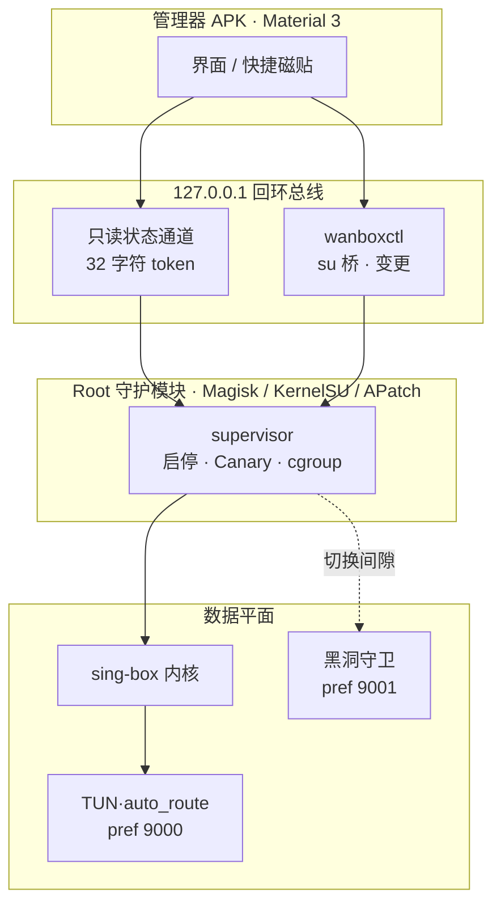

  

  <h1>wanBox for Android</h1>

  
<strong>面向已 Root 设备的系统级代理管理器</strong>

  
瘦管理器 APK · Root 守护模块 · sing-box 原生内核 · 内核态 TUN 透明路由 · 不走 VPN 框架

  

    
    
    
    
  

  

    <b><a href="https://github.com/Wuwan94/wanBoxForAndroid/releases/latest">下载最新版</a></b> ·
    <a href="#核心特性">核心特性</a> ·
    <a href="#架构速览">架构速览</a> ·
    <a href="#下载与安装">下载与安装</a> ·
    <a href="#常见问题">常见问题</a> ·
    <a href="#项目文档">项目文档</a>
  

  
Android 12+ (API 31+) · arm64-v8a · Magisk / KernelSU / APatch · 开源

> **版本发布**：当前已发布正式版为 [v3.0.17](https://github.com/Wuwan94/wanBoxForAndroid/releases/tag/v3.0.17)，已发布预览版为 [v3.0.19-preview.2](https://github.com/Wuwan94/wanBoxForAndroid/releases/tag/v3.0.19-preview.2)。上一正式版 [v3.0.14](https://github.com/Wuwan94/wanBoxForAndroid/releases/tag/v3.0.14) 与 [v3.0.11](https://github.com/Wuwan94/wanBoxForAndroid/releases/tag/v3.0.11) 保留可回退。

Published releases: stable v3.0.17 and preview v3.0.19-preview.2.

---

| ≈6 MiB | 0 个 | 5 秒 | 26 MiB |
|:--:|:--:|:--:|:--:|
| 管理器 APK，不含原生核心 | VPN 权限，不碰 VpnService | Canary 观察窗，失败回滚 | 双产物硬门禁，APK + 模块 |

## 项目简介

wanBox 把「界面」和「代理本体」拆成两件独立的事。管理器只是一个薄的 Material 3 界面，APK 里没有任何原生核心；真正的代理由 Root 模块承载 —— Magisk / KernelSU / APatch 负责加载它，它自己持有 sing-box 进程、TUN 接口与策略路由的生命周期。

所以它不申请 VPN 权限，状态栏里没有 VPN 钥匙图标，也没有 `VpnService` 在应用进程里守着一条常驻链路：管理器退出或被系统回收，代理照常运行；管理器进程里没有 JNI 常驻内存，也就没有被 LMK 连带查杀的问题。

> **项目定位**：wanBox 是客户端与模块工具套件，不内置、也不提供任何代理订阅或节点。连接速度、延迟与服务可用性取决于网络环境与节点配置。

## 与 VPN 客户端的差别

| 对比项 | 传统 VpnService 客户端 | wanBox |
|:--|:--|:--|
| 代理进程 | 应用内的 `VpnService` 加原生核心常驻 | Root 模块内的 sing-box，管理器不承载核心 |
| 系统权限 | 申请 VPN 权限，状态栏常驻钥匙图标 | 不申请 VPN 权限，状态栏无 VPN 图标 |
| 存活边界 | 靠前台服务与省电白名单保活，清理即掉线 | 由 supervisor 持有核心，管理器被杀不影响连接 |
| 流量接管 | 应用级 VPN 路由，随应用进程起落 | TUN + `auto_route` 策略路由，按分应用规则出站 |

## 核心特性

<table>
  <tr>
    <td width="50%" valign="top">
      <h3>🧩 瘦管理器</h3>
      管理器 APK 只有 6 MiB 级，不含 <code>libgojni.so</code> 一类的原生核心，界面进程里没有 JNI 常驻内存；应用列表用 120 项原生 <code>LruCache</code> 缓存图标，滚动不重复解码。
    </td>
    <td width="50%" valign="top">
      <h3>🛡️ Root 系统级承载</h3>
      sing-box 进程、TUN 接口与 <code>auto_route</code> 策略路由都由 Root 模块持有：没有 VPN 钥匙图标，没有前台服务保活焦虑，管理器退出或被回收也不掉线。
    </td>
  </tr>
  <tr>
    <td width="50%" valign="top">
      <h3>🚧 Fail-Closed，绝不静默直连</h3>
      更新检查与测速只向 <code>127.0.0.1</code> 的本地入口发请求；本地代理没起来就直接失败并如实提示，不回退直连、不泄露真实 IP。
    </td>
    <td width="50%" valign="top">
      <h3>⚡ 5 秒 Canary + 黑洞守卫</h3>
      热切换前先在 <code>pref 9001</code> 挂瞬态黑洞（TUN 规则在 <code>pref 9000</code>），切换后开 5 秒观察窗，探测不过自动回滚；退出与卸载循环净空规则，不留断网孤儿。
    </td>
  </tr>
  <tr>
    <td width="50%" valign="top">
      <h3>📡 4 秒状态通道</h3>
      supervisor 内嵌 <code>127.0.0.1</code> 只读 HTTP 通道，32 字符十六进制 token 鉴权，状态快照缓存 4 秒 —— 前台刷新不再为每个采样点 fork 一次 <code>su</code>，变更操作仍只走 <code>wanboxctl</code>。
    </td>
    <td width="50%" valign="top">
      <h3>🧮 内存软限与工程门禁</h3>
      守护进程驻入专属 <code>wanbox</code> 子 cgroup，<code>memory.high</code> 取 <code>MemTotal/4</code> 并钳制在 256 MiB–4 GiB；双产物 26 MiB 硬门禁、Python 门禁脚本与 Go / Android 单测随 CI 全量把关。
    </td>
  </tr>
</table>

## 架构速览

一个管理器、一个守护模块、一颗内核：三者之间只靠一条回环总线通话。

| 层 | 组成 | 关键机制 |
|:--|:--|:--|
| 管理器 | Kotlin · Material 3，APK 无原生库 | 只经回环读状态；所有变更走 `wanboxctl`（su 桥） |
| 回环总线 | `127.0.0.1` 只读状态通道 · Clash API `127.0.0.1:9090` | 状态通道以 32 字符十六进制 token 鉴权、按契约只读；变更不落在通道上 |
| 守护模块 | Magisk / KernelSU / APatch 脚本 + supervisor | 启停、5 秒 Canary 看门狗、cgroup 治理、规则下发 |
| 数据平面 | sing-box `v1.15.0-alpha.13-reF1nd` | TUN 接口 + `auto_route` 策略路由，按分应用规则精准出站 |

## 运行要求

| 需要 | 不需要 |
|:--|:--|
| Android 12+（API 31+），targetSdk 35 | VPN 权限，或任何 VPN 模式回退 |
| 仅 `arm64-v8a` 设备（x86_64 只做内部验证） | 32 位或 x86 设备 |
| Magisk / KernelSU / APatch 之一，并允许安装本模块 | 常驻的管理器进程 |

## 下载与安装

安装包统一在 [GitHub Releases](https://github.com/Wuwan94/wanBoxForAndroid/releases/latest) 发布，说明、资产与校验和同页提供。

| 渠道 | 正式版 | 尝鲜预览 |
|:--|:--|:--|
| 版本 | [v3.0.17](https://github.com/Wuwan94/wanBoxForAndroid/releases/tag/v3.0.17)（非 prerelease） | [v3.0.19-preview.2](https://github.com/Wuwan94/wanBoxForAndroid/releases/tag/v3.0.19-preview.2)（prerelease） |
| 版本码 | APK `10175` · 模块码 `2035` | APK `10207` · 模块码 `2041` |
| 体积 | APK 6.07 MiB · 模块 17.29 MiB · 合一包 22.67 MiB | APK 6.09 MiB · 模块 17.46 MiB · 合一包 22.86 MiB |
| 适合 | 稳定优先，日常使用 | 想先试新功能，可随时回退 |

| 资产 | 用途 |
|:--|:--|
| **合一包** · 推荐 | `wanbox-root-module-with-manager-arm64-v8a.zip` —— 模块 + 管理器，刷入即用 |
| 管理器 APK | `wanBoxForAndroid-3.0.17-arm64-v8a.apk` —— 只更新管理器（需已装同版模块） |
| Root 模块 | `wanbox-root-module-arm64-v8a.zip` —— 只更新内核与 `wanboxctl` |
| 校验和 | `SHA256SUMS` —— 上面三项的校验和，安装前先 `sha256sum --check` |

**正式版安装三步：**

1. 下载合一包 `wanbox-root-module-with-manager-arm64-v8a.zip`（也可按需只下 APK 或模块 ZIP）。
2. 在 Magisk / KernelSU / APatch 里本地刷入，然后重启手机，让 `auto_route` 与挂载命名空间干净重载。
3. 开机后打开 wanBox 管理器，导入订阅或节点配置即可。

> ⚠️ **成套同版**：管理器 APK 内不含核心，必须与同一个 Release 页里的 Root 模块（v3.0.17 对应模块码 `2035`）一起安装或更新。**严禁跨版本混用。**

<strong>尝鲜预览 · v3.0.19-preview.2</strong>（与正式版并行发布，各自成套使用）

 

本版收录 PR #94 的 VLESS XHTTP 服务端加固，并由 PR #95 升版发布。`Preview Build` run `45426378108`（#63）于 2026-11-24T15:55:00Z 发布，tag 与资产提交均为 `9f4299e50aa88bc6f385daf4663828e07528036d`。PR #94 加入滚动上传读取超时与分层资源配额、会话来源及请求校验、乱序缓冲溢出时关闭会话并释放数据、`stream-up` 续接与 `stream-one` 并发竞态修复，以及 XHTTP 回归/Go race CI；通过现有节点自定义 JSON 配置启用，官方 sing-box 内核与 `SINGBOX_VERSION` 未改。

| 资产 | 文件名 | 体积 |
|:--|:--|--:|
| 瘦身管理器 APK（`versionCode=10207`） | `wanBoxForAndroid-3.0.19-preview.2-arm64-v8a-release.apk` | 6.09 MiB |
| Root 模块 ZIP（模块码 `2041`） | `wanbox-root-module-arm64-v8a.zip` | 17.46 MiB |
| 模块 + 管理器合一 ZIP | `wanbox-root-module-with-manager-arm64-v8a.zip` | 22.86 MiB |

- 下载：[v3.0.19-preview.2 Release](https://github.com/Wuwan94/wanBoxForAndroid/releases/tag/v3.0.19-preview.2)
- 直链（合一包）：[wanbox-root-module-with-manager-arm64-v8a.zip](https://github.com/Wuwan94/wanBoxForAndroid/releases/download/v3.0.19-preview.2/wanbox-root-module-with-manager-arm64-v8a.zip)
- 直链（管理器 APK）：[wanBoxForAndroid-3.0.19-preview.2-arm64-v8a-release.apk](https://github.com/Wuwan94/wanBoxForAndroid/releases/download/v3.0.19-preview.2/wanBoxForAndroid-3.0.19-preview.2-arm64-v8a-release.apk)
- 直链（Root 模块）：[wanbox-root-module-arm64-v8a.zip](https://github.com/Wuwan94/wanBoxForAndroid/releases/download/v3.0.19-preview.2/wanbox-root-module-arm64-v8a.zip)
- 直链（SHA-256 清单）：[SHA256SUMS](https://github.com/Wuwan94/wanBoxForAndroid/releases/download/v3.0.19-preview.2/SHA256SUMS)
- 校验：同一 Release 页的 `SHA256SUMS`（APK 与两个模块包逐行对得上，安装前先 `sha256sum --check`）。
- 回退：换回正式版 [v3.0.17](https://github.com/Wuwan94/wanBoxForAndroid/releases/tag/v3.0.17) 的 APK 与配套模块（模块码 `2035`）成套重装，不要跨 Release 混用。
- 逐项修复说明见 [PREVIEW_NOTES.md](PREVIEW_NOTES.md)。

四件套经 GitHub Release API 核验：APK `6381543` B / `c9884dcc…3cef1e`、普通 Root ZIP `18308156` B / `e0700880…f059c6`、合一 ZIP `23965220` B / `8fcaa9d3…e184c7d48`、`SHA256SUMS` `333` B / `52eefd6f…d1f85abc2`。APK + 普通模块合计 `24689699` B（23.55 MiB），低于 26 MiB 上限；Xray 互通复核使用后续本地分支修复，不代表已发布 preview.2 资产经过该复测，真机验证仍未执行。

## 常见问题

<strong>为什么状态栏没有 Android 系统的 VPN 钥匙图标？</strong>

 
因为 wanBox 不走 Android 传统的 <code>VpnService</code>：Root 模块在 Linux 内核层建立 TUN 接口，由 sing-box 的 <code>auto_route</code> 接管策略路由。
<ul>
  <li><b>更省电</b>：不需要应用进程守一条 VPN 链路，也没有 <code>VpnService</code> 在用户态与内核态之间来回搬运；</li>
  <li><b>更稳定</b>：不会因为系统清理普通 VPN 应用而掉线，代理进程由 Root 守护模块保持持久生命周期。</li>
</ul>

<strong>为什么更新或测速时提示本地代理未就绪？</strong>

 
这是 <b>Fail-Closed（故障阻断）</b> 在生效：更新检查与测速只向 <code>127.0.0.1</code> 的本地入口发请求，代理没起来时直接失败，绝不静默走直连发请求，以免泄露真实 IP。遇到「Clash API 未就绪或服务未启动」或「Root TUN 尚未就绪」时，先用快捷磁贴或管理器把模块的核心服务正常启动，确认本地回环端口已监听。

<strong>模块更新后需要重启手机吗？</strong>

 
<b>建议重启。</b>在 Magisk / KernelSU / APatch 里刷入新版 Root 模块后，重启能确保内核核心、TUN 接口、<code>auto_route</code> 规则与守护脚本彻底重新加载，避免旧进程残留或端口被占用。

<strong>瘦管理器 APK 和 Root 模块 ZIP 的匹配原则是什么？</strong>

 
严格执行<b>「成套同版」</b>：管理器里不含核心二进制，它的配置生成规范、协议结构与版本戳检查都与同版模块绑定。请从同一个 Release 发布页下载成套的 APK 与模块 ZIP，不要跨版本混用。

<strong>切换或卸载时会不会留下断网规则？</strong>

 
不会。切换节点时先在 <code>pref 9001</code> 挂瞬态黑洞，切换完成即循环删除该规则直到一条不剩；退出与卸载同样走净空流程，不会留下把流量吸走的孤儿规则。

## 项目文档

| 文档 | 内容 |
|:--|:--|
| [技术文档中心](docs/README.md) | 架构、路由、性能、UI 规范与历史归档的总入口 |
| [版本发布对照](docs/current-version.zh-CN.md) | 正式版与已发布预览的提交、版本码与资产 SHA-256 |
| [分阶段发布清单](docs/release-checklist.zh-CN.md) | G1–G13 门禁与两阶段发布流程 |
| [更新日志](CHANGELOG.md) | 逐版变更记录 |
| [正式发布说明](RELEASE_NOTES.md) · [预览说明](PREVIEW_NOTES.md) | 当前发布内容与回退指引 |
| [贡献指南](CONTRIBUTING.md) · [安全策略](SECURITY.md) | 参与开发、威胁模型与漏洞报告 |

## 社区与反馈

| 渠道 | 地址 |
|:--|:--|
| Telegram 频道 | [@OwnBoxs](https://t.me/OwnBoxs) |
| 问题反馈 | [GitHub Issues](https://github.com/Wuwan94/wanBoxForAndroid/issues) |
| 参与开发 | 欢迎读代码、提 PR，先在 [贡献指南](CONTRIBUTING.md) 里看一眼流程 |

---

  
<strong>wanBox · Clean, robust, root-powered proxy for Android.</strong>

  
如果 wanBox 对你有帮助，点亮一颗 ⭐，或把问题丢进 Telegram 频道。

  
基于 <a href="LICENSE">GPL-3.0</a> 开源 · 不内置任何代理订阅

  
<strong>English</strong> — Show the English overview

  

    <h3>wanBox for Android</h3>
    
<strong>A root-first proxy manager: a thin Material 3 app on top of a root module that owns the core.</strong>

    

      <a href="https://github.com/Wuwan94/wanBoxForAndroid/releases/latest">Download</a> ·
      <a href="https://github.com/Wuwan94/wanBoxForAndroid/issues">Issues</a> ·
      <a href="https://t.me/OwnBoxs">Telegram</a>
    

  

  ### Highlights

  - **Thin manager:** a 6 MiB-class APK with no native core inside (no `libgojni.so` in app memory), so no JNI residency and no LMK collateral kill; a 120-entry `LruCache` keeps the app list smooth.
  - **Root-owned data plane:** the Magisk / KernelSU / APatch module holds the sing-box process, the TUN interface and `auto_route` policy routing — no `VpnService`, no VPN key icon, and the connection survives the manager being killed.
  - **Fail-Closed by default:** update checks and latency probes go strictly through `127.0.0.1`; nothing silently falls back to a direct connection.
  - **5-second canary:** a transient `pref 9001` blackhole covers the switch gap, and a failed post-switch probe rolls the configuration back automatically; teardown drains the rule instead of leaving it behind.
  - **Loopback status channel:** read-only, 32-hex-token authenticated, with 4-second cached snapshots, so the UI no longer forks `su` per sample; mutations still go through `wanboxctl`.
  - **Memory and size gates:** the daemon runs in its own `wanbox` child cgroup with `memory.high` at `MemTotal/4` clamped to 256 MiB–4 GiB; a 26 MiB budget covers the APK plus the module ZIP, enforced with the Python, Go and Android test suites in CI.

  ### Requirements

  Android 12+ (API 31+), `arm64-v8a`, and Magisk / KernelSU / APatch. The manager APK and the root module ZIP must come from the same release; mixing versions is not supported.

  Licensed under [GPL-3.0](LICENSE). wanBox ships no proxy subscription or nodes of any kind.

