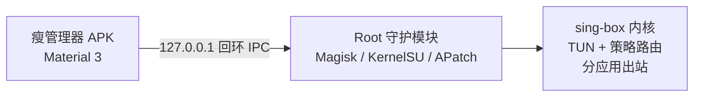

  

  <h1>wanBox for Android</h1>

  
<strong>面向已 Root 设备的系统级代理管理器</strong>

  
瘦管理器 APK + Root 守护模块 · sing-box 原生内核 · 内核态 TUN 透明路由 · 不走 VPN 框架

  

    
    
    
    
  

  

    <b><a href="https://github.com/Wuwan94/wanBoxForAndroid/releases/latest">下载最新版</a></b> ·
    <a href="#核心特性">核心特性</a> ·
    <a href="#架构速览">架构速览</a> ·
    <a href="#下载与安装">下载与安装</a> ·
    <a href="#常见问题">常见问题</a> ·
    <a href="#项目文档">项目文档</a>
  

  
Android 12+ (API 31+) · arm64-v8a · Magisk / KernelSU / APatch · Open Source

> **版本发布**：当前已发布正式版为 [v3.0.14](https://github.com/Wuwan94/wanBoxForAndroid/releases/tag/v3.0.14)，已发布预览版为 [v3.0.16-preview.2](https://github.com/Wuwan94/wanBoxForAndroid/releases/tag/v3.0.16-preview.2)。

Published releases: stable v3.0.14 and preview v3.0.16-preview.2.

---

## 项目简介

wanBox 把「界面」和「代理本体」拆成两件独立的事：管理器只是一个薄薄的 Material 3 界面（APK 内没有任何原生核心），真正的代理由 Root 模块承载——Magisk / KernelSU / APatch 负责加载它，它自己持有 sing-box 进程、TUN 接口与策略路由的生命周期。

所以它不申请 VPN 权限、状态栏里没有 VPN 钥匙图标，也没有 `VpnService` 在用户态与内核态之间的重复拷贝：管理器退出或被系统回收，代理照常运行；管理器进程里没有 JNI 常驻内存，也就没有被 LMK 连带查杀的问题。

> **项目定位**：wanBox 是客户端与模块工具套件，不内置、也不提供任何代理订阅或节点。连接速度、延迟与服务可用性取决于网络环境与节点配置。

## 核心特性

<table>
  <tr>
    <td width="50%" valign="top">
      <strong>瘦管理器，无核心常驻</strong> 
      管理器 APK 约 5.9 MiB，不含 <code>libgojni.so</code> 一类的原生核心，界面进程内没有任何 JNI 常驻内存；分应用列表用 120 项原生 <code>LruCache</code> 缓存图标，滚动流畅、冷启动毫秒级。
    </td>
    <td width="50%" valign="top">
      <strong>Root 系统级承载</strong> 
      sing-box 进程、TUN 接口与系统级策略路由由 Root 模块持有：状态栏无 VPN 钥匙图标，没有 VPN 保活焦虑，管理器被杀也不掉线。
    </td>
  </tr>
  <tr>
    <td width="50%" valign="top">
      <strong>Fail-Closed 与黑洞净空</strong> 
      网络探测与更新检查严格只经 <code>127.0.0.1</code>，核心未就绪时直接阻断，绝不静默回退直连；切换间隙注入 <code>pref 9001</code> 瞬态黑洞，退出与卸载时循环净空，不留断网孤儿规则。
    </td>
    <td width="50%" valign="top">
      <strong>5 秒 Canary 免重启热更新</strong> 
      配置热更新后开 5 秒观察窗，探测不通过即自动回滚到上一份可用状态：不用重启手机，也不用手动救场。
    </td>
  </tr>
  <tr>
    <td width="50%" valign="top">
      <strong>毫秒级状态通道</strong> 
      supervisor 内嵌 <code>127.0.0.1</code> 只读 HTTP 通道，状态读取按 4 秒聚合，前台刷新不再为每个采样点 fork 一次 <code>su</code>。
    </td>
    <td width="50%" valign="top">
      <strong>内存软限与工程门禁</strong> 
      守护进程驻入专属 <code>wanbox</code> 子 cgroup，<code>memory.high</code> 取 <code>MemTotal/4</code> 并钳制在 256 MiB–4 GiB，高水位主动 GC；双产物 26 MiB 硬门禁与 108 项离线单测随 CI 把关。
    </td>
  </tr>
</table>

## 架构速览

一个管理器、一个守护模块、一颗内核：三者之间只靠一条回环总线通话。

| 层 | 组成 | 关键机制 |
|:--|:--|:--|
| 管理器 | Kotlin · Material 3，APK 无原生库 | 只经回环观察状态；所有变更操作走 `wanboxctl`（su 桥） |
| 回环总线 | `127.0.0.1` 只读状态通道 · Clash API `127.0.0.1:9090` | 状态通道以 32 字符十六进制 token 鉴权、按契约只读；变更不落在通道上 |
| 守护模块 | Magisk / KernelSU / APatch 脚本 + supervisor | 启停、5 秒 Canary 看门狗、cgroup 治理、规则下发 |
| 内核与路由 | sing-box `v1.15.0-alpha.13-reF1nd` | TUN 接口 + iptables 策略路由，按分应用规则精准出站 |

## 运行要求

| 项 | 要求 |
|:--|:--|
| 系统 | Android 12+（API 31+），targetSdk 35 |
| 架构 | 仅发布 `arm64-v8a`，x86_64 只用于内部验证 |
| Root | Magisk / KernelSU / APatch 之一，需允许安装并启用本模块 |
| 网络 | 不申请 VPN 权限，没有 VPN 模式回退 |
| 内核 | sing-box `v1.15.0-alpha.13-reF1nd`，随 Root 模块分发 |

## 下载与安装

安装包统一在 [GitHub Releases](https://github.com/Wuwan94/wanBoxForAndroid/releases/latest) 发布（当前正式版 [v3.0.14](https://github.com/Wuwan94/wanBoxForAndroid/releases/tag/v3.0.14)），说明、资产与校验和同页提供。

| 资产 | 用途 |
|:--|:--|
| **合一包** · 推荐 | `wanbox-root-module-with-manager-arm64-v8a.zip` — 模块 + 管理器，刷入即用 |
| 管理器 APK | `wanBoxForAndroid-3.0.14-arm64-v8a.apk` — 只更新管理器（需已装同版模块） |
| Root 模块 | `wanbox-root-module-arm64-v8a.zip` — 只更新内核与 `wanboxctl` |
| 校验和 | `SHA256SUMS` — 上面三项的校验和，安装前先 `sha256sum --check` |

> ⚠️ **成套同版**：管理器 APK 内不含核心，必须与同一个 Release 页里的 Root 模块（v3.0.14 对应模块码 `2026`）一起安装或更新。**严禁跨版本混用。**

1. 下载推荐的合一包 `wanbox-root-module-with-manager-arm64-v8a.zip`。
2. 在 Magisk / KernelSU / APatch 里本地刷入，然后重启手机，让全局 iptables 规则链与挂载命名空间干净重载。
3. 开机后打开 wanBox 管理器，导入订阅或节点配置即可。

<strong>尝鲜预览 · v3.0.16-preview.2</strong>（与正式版并行发布，各自成套使用）

 

预览线只跟随复审修复、不新增功能：统一手动恢复与自动启停监控的网络指纹口径，并加固网关缓存并发、确认定时器与弹窗超时反馈。

| 资产 | 体积 |
|:--|--:|
| 瘦身管理器 APK（`versionCode=10147`） | 5.94 MiB |
| Root 模块 ZIP（模块码 `2029`） | 17.12 MiB |
| 模块 + 管理器合一 ZIP | 22.41 MiB |

- 下载：[v3.0.16-preview.2 Release](https://github.com/Wuwan94/wanBoxForAndroid/releases/tag/v3.0.16-preview.2)
- 回退：换回 [v3.0.14](https://github.com/Wuwan94/wanBoxForAndroid/releases/tag/v3.0.14) 的 APK 与配套模块（模块码 `2026`）成套重装，不要跨 Release 混用。
- 逐项修复说明见 [PREVIEW_NOTES.md](PREVIEW_NOTES.md)。

## 常见问题

<strong>为什么状态栏没有 Android 系统的 VPN 钥匙图标？</strong>

 
因为 wanBox 不走 Android 传统的 <code>VpnService</code>：Root 模块直接在 Linux 内核层建立 TUN 接口，并用 iptables 做透明代理转发。
<ul>
  <li><b>更省电</b>：省掉系统 VPN 框架在用户态与内核态之间的重复拷贝；</li>
  <li><b>更稳定</b>：不会因为系统清理普通 VPN 应用而掉线，代理进程由 Root 守护模块保持持久生命周期。</li>
</ul>

<strong>为什么检查更新或测速时报错「代理未启动」？</strong>

 
这是 <b>Fail-Closed（故障阻断）</b> 在生效：wanBox 绝不在代理未就绪时静默走直连发请求，以免泄露真实 IP。遇到此提示时，请先用快捷磁贴或管理器把模块的核心服务正常启动，确认本地 <code>127.0.0.1</code> 回环端口已监听。

<strong>模块更新后需要重启手机吗？</strong>

 
<b>建议重启。</b>在 Magisk / KernelSU / APatch 里刷入新版 Root 模块后，重启能确保全局 iptables 规则链、挂载命名空间与守护脚本彻底重新加载，避免旧进程残留或端口被占用。

<strong>瘦管理器 APK 和 Root 模块 ZIP 的匹配原则是什么？</strong>

 
严格执行<b>「成套同版」</b>：管理器里不含核心二进制，它的配置生成规范、REST 协议结构与版本戳检查都与同版模块绑定。请从同一个 Release 发布页下载成套的 APK 与模块 ZIP，不要跨版本混用。

## 项目文档

- [技术文档中心](docs/README.md) — 架构、路由、性能、UI 规范与历史归档的总入口
- [版本发布对照](docs/current-version.zh-CN.md) — 正式版与已发布预览的提交、版本码与资产哈希
- [分阶段发布清单](docs/release-checklist.zh-CN.md) — G1–G13 门禁与两阶段发布流程
- [更新日志](CHANGELOG.md) · [正式发布说明](RELEASE_NOTES.md) · [预览说明](PREVIEW_NOTES.md)
- [贡献指南](CONTRIBUTING.md) · [安全策略](SECURITY.md)

## 社区与反馈

| 渠道 | 地址 |
|:--|:--|
| Telegram 频道 | [@OwnBoxs](https://t.me/OwnBoxs) |
| 问题反馈 | [GitHub Issues](https://github.com/Wuwan94/wanBoxForAndroid/issues) |
| 参与开发 | 欢迎读代码、提 PR，先在 [贡献指南](CONTRIBUTING.md) 里看一眼流程 |

---

  
<strong>wanBox · Clean, robust, root-powered proxy for Android.</strong>

  
如果 wanBox 对你有帮助，点亮一颗 ⭐，或把问题丢进 Telegram 频道。

  
基于 <a href="LICENSE">GPL-3.0</a> 开源 · 不内置任何代理订阅

  
<strong>English</strong> — Show the English overview

  

    <h3>wanBox for Android</h3>
    
<strong>A root-first proxy manager: a thin Material 3 app on top of a root module that owns the core.</strong>

    

      <a href="https://github.com/Wuwan94/wanBoxForAndroid/releases/latest">Download</a> ·
      <a href="https://github.com/Wuwan94/wanBoxForAndroid/issues">Issues</a> ·
      <a href="https://t.me/OwnBoxs">Telegram</a>
    

  

  ### Highlights

  - **Thin manager:** ~5.9 MiB APK with no native core inside (no `libgojni.so` in app memory), so no JNI residency and no LMK collateral kill.
  - **Root-owned core:** the Magisk / KernelSU / APatch module holds the sing-box process, the TUN interface and system policy routing; no `VpnService`, no VPN key icon, no keep-alive anxiety.
  - **Fail-Closed by default:** probes and update checks go strictly through `127.0.0.1`; nothing silently falls back to a direct connection.
  - **5-second Canary hot update:** a failed post-switch probe rolls the configuration back automatically, without a reboot.
  - **Loopback status channel:** a read-only channel with 4-second read aggregation replaces per-sample `su` forks; the daemon sits in its own child cgroup with `memory.high` at `MemTotal/4` clamped to 256 MiB–4 GiB.
  - **Engineering gates:** 26 MiB budget for the APK plus module, 108 offline unit tests, single-source version codes.

  ### Requirements

  Android 12+ (API 31+), `arm64-v8a`, and Magisk / KernelSU / APatch. The manager APK and the root module ZIP must come from the same release; mixing versions is not supported.

  Licensed under [GPL-3.0](LICENSE). wanBox ships no proxy subscription or nodes of any kind.

