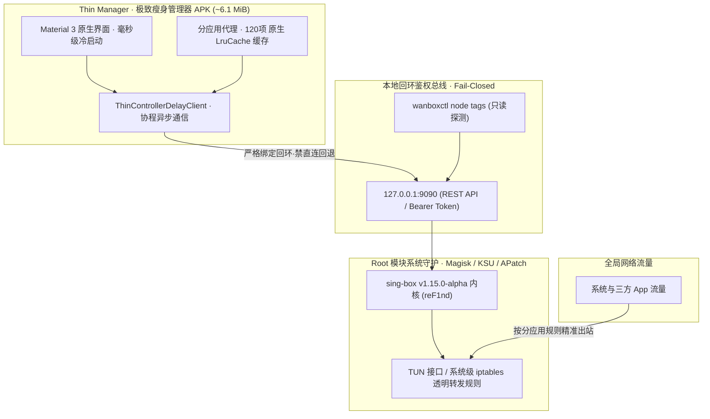

  
   
  <h1>wanBox for Android</h1>
  
<strong>面向已 Root 设备的高性能 Android 代理管理器与系统级核心套件。</strong>

  
基于原生 sing-box 内核打造 · 瘦管理器架构 · 系统级 TUN 透明路由 · 严苛 Fail-Closed

  

    
    
    
    
  

  

    
    
    
  

  

    Android 12+ (API 31+) · arm64-v8a · Magisk / KernelSU / APatch · Open Source
  

> **版本发布**：当前已发布正式版为 [v3.0.14](https://github.com/Wuwan94/wanBoxForAndroid/releases/tag/v3.0.14)，已发布预览版为 [v3.0.15-preview.1](https://github.com/Wuwan94/wanBoxForAndroid/releases/tag/v3.0.15-preview.1)。

Published releases: stable v3.0.14 and preview v3.0.15-preview.1.

---

## ✦ 项目简介

**wanBox** 是一款面向已 Root 设备的现代化 Android 代理管理器与系统级核心套件。项目基于原生 **sing-box** 内核打造，采用“瘦身管理器 + Root 守护进程”双层解耦架构，通过 Linux 内核原生 TUN 接口与系统级透明代理实现高性能网络接管。

与依赖 Android 传统 `VpnService` 的普通代理应用不同，wanBox 完全消除 VPN 框架在用户态与内核态的重复拷贝，状态栏无系统 VPN 钥匙图标，零 VPN 接口额外耗电与后台保活焦虑。

> **项目定位：** wanBox 为客户端及模块工具套件，不内置或提供任何第三方代理订阅。实际连接速度、延迟与各服务可用状态取决于网络环境与节点配置。

## ✨ 核心功能

<table>
  <tr>
    <td width="50%" valign="top">
      <h3>🪶 瘦身架构与零常驻</h3>
      
管理器 APK 仅约 6.1 MiB，彻底剥离 JNI 核心二进制（无 <code>libgojni.so</code> 常驻内存），消除内存泄漏与系统低内存（LMK）连带查杀，毫秒级冷启动。

    </td>
    <td width="50%" valign="top">
      <h3>⚡ 原生 Root 系统级承载</h3>
      
由 Magisk / KernelSU / APatch 模块持有核心进程与独立 TUN 路由生命周期，系统透明代理直出，无 VPN 钥匙图标，零 VPN 额外开销与保活困扰。

    </td>
  </tr>
  <tr>
    <td width="50%" valign="top">
      <h3>🔒 严苛 Fail-Closed 安全边界</h3>
      
更新检查与延迟探测严格经由 <code>127.0.0.1</code> 走本地 mixed 代理，核心未启动时确定性阻断，坚决不回退直连，杜绝真实 IP 泄漏。

    </td>
    <td width="50%" valign="top">
      <h3>🏎️ 智能分应用与 LruCache 缓存</h3>
      
应用图标与标签后台协程异步解析，搭配 120 项原生内存 <code>LruCache</code>，快速滑动零白块、零掉帧，杜绝主线程阻塞与重复 IPC 调用。

    </td>
  </tr>
  <tr>
    <td width="50%" valign="top">
      <h3>🎛️ 原子化 QS Tile 快捷磁贴</h3>
      
通知栏快捷磁贴引入防抖状态机，过滤 Connecting / Stopping 过渡态；状态切换前强读物理真值，并发调用加锁保护。

    </td>
    <td width="50%" valign="top">
      <h3>🛡️ 25 MiB 预算与严谨工程</h3>
      
管理器与模块双产物严守 25 MiB 硬门禁；108 项离线自动化单测全量覆盖，版本码单源绑定防漂移，守护每一份构建证据。

    </td>
  </tr>
</table>

## 🏛️ 系统架构

wanBox 采用**“界面与核心解耦、三层架构划分、Root 原生承载”**的设计体系：

- **界面端零核心常驻**：彻底剥离 `libgojni.so` 与 JNI 绑定，杜绝内存泄漏与被系统低内存查杀（LMK）连带终止。
- **Fail-Closed 绝对防泄漏**：网络探测与更新检查严格经由 `127.0.0.1`，核心未启动时直接 Fail-Closed 阻断，坚决不回退直连。

## 📥 下载与安装

### 最新版本

  

建议优先打开 [**GitHub Releases 最新发布页**](https://github.com/Wuwan94/wanBoxForAndroid/releases/latest)，查看当前版本的说明、安装包与校验文件。

### 发行资产清单

| 资产名称 | 类型 | 适用场景 | 下载 | 校验 |
|:--|:--|:--|:--:|:--:|
| **wanbox-root-module-with-manager-arm64-v8a.zip** · 推荐 | 模块 + 管理器合一 | 刷入即用，开箱内含同版本管理器 | [下载 ZIP](https://github.com/Wuwan94/wanBoxForAndroid/releases/latest) | [SHA-256](https://github.com/Wuwan94/wanBoxForAndroid/releases/latest) |
| **wanBoxForAndroid-*.apk** | 瘦身管理器 APK | 独立管理器（约 6.1 MiB），需搭配已安装模块 | [下载 APK](https://github.com/Wuwan94/wanBoxForAndroid/releases/latest) | [SHA-256](https://github.com/Wuwan94/wanBoxForAndroid/releases/latest) |
| **wanbox-root-module-arm64-v8a.zip** | 独立 Root 模块 | 纯内核与守护进程（sing-box v1.15.0-alpha） | [下载 ZIP](https://github.com/Wuwan94/wanBoxForAndroid/releases/latest) | [SHA-256](https://github.com/Wuwan94/wanBoxForAndroid/releases/latest) |

> ⚠️ **成套同版配对原则**：瘦管理器 APK 内部不含核心，**必须与同一发布页中的 Root 模块同步安装或更新**，严禁跨版本混用。

### 快速安装步骤

1. **下载模块**：从最新 Release 页面下载推荐的合一模块包 `wanbox-root-module-with-manager-arm64-v8a.zip`。
2. **刷入并重启**：在 Magisk、KernelSU 或 APatch 管理器中选择模块本地刷入，完成后重启手机。
3. **完成配置**：开机后打开桌面上的 wanBox 管理器，导入订阅或节点配置即可畅享系统级代理。

## 🧩 技术栈

| 组件 | 规范与版本 | 说明 |
|:--|:--|:--|
| 系统支持 | Android 12+ (API 31+) | 仅支持 arm64-v8a 架构已 Root 设备 |
| 承载环境 | Magisk / KernelSU / APatch | 系统级 TUN 接口与透明代理路由 |
| 管理端语言 | Kotlin (SDK 35 / JDK 17) | Material 3 原生界面，轻量瘦身设计 |
| 核心引擎 | sing-box `v1.15.0-alpha.13-reF1nd` | 纯 Go 内核，系统守护进程常驻 |
| 自动化 | GitHub Actions CI / CD | 108 项离线门禁、Fail-Closed 与 25MB 体积校验 |

## ❓ 常见问题 / FAQ

<b>Q1: 为什么状态栏没有 Android 系统的 VPN 钥匙图标？</b>

 
wanBox 是一套面向已 Root 设备的系统级方案，底层直接在 Linux 内核层构建 TUN 接口并利用 iptables 进行透明代理转发，而不是走 Android 传统的 <code>VpnService</code>。
<ul>
  <li><b>极致性能</b>：消除系统 VPN 框架在用户态与内核态之间的重复拷贝，网络开销更低、更省电；</li>
  <li><b>永不掉线</b>：不会因为系统清理普通 VPN 应用而后门掉线或断网，由 Root 守护进程保持持久生命周期。</li>
</ul>

<b>Q2: 为什么检查更新或测速时报错“代理未启动”？</b>

 
这是 wanBox 严苛的 <b>Fail-Closed（故障阻断）安全边界</b> 在生效。wanBox 绝不在代理未就绪时静默使用直连网络发送请求，以免向外界泄露您的真实 IP。当遇到此提示时，请确保模块的核心服务已通过快捷磁贴或管理器正常启动，并在本地 127.0.0.1 回环端口上正常监听。

<b>Q3: 模块更新后需要重启手机吗？</b>

 
<b>建议重启。</b>在 Magisk / KernelSU / APatch 中刷入新版 Root 模块后，重启设备能确保系统的全局 iptables 规则链、挂载命名空间以及守护脚本彻底干净地重新加载，避免出现旧进程残留或端口被占用的隐患。

<b>Q4: 瘦管理器 APK 和 Root 模块 ZIP 的匹配原则是什么？</b>

 
必须严格执行<b>“成套同版配对原则”</b>。由于瘦管理器内不含核心二进制，其配置生成规范、REST 协议结构与版本戳检查均与同发布的 Root 模块深度绑定。请务必从同一个 Release 发布页下载成套的 APK 与模块 ZIP 进行安装，切勿跨版本混用。

## 🗺️ 项目文档

- [📖 技术文档中心 (docs/README.md)](docs/README.md)
- [📌 版本发布对照 (docs/current-version.zh-CN.md)](docs/current-version.zh-CN.md)
- [📋 分阶段发布清单 (docs/release-checklist.zh-CN.md)](docs/release-checklist.zh-CN.md)
- [📝 更新日志 (CHANGELOG.md)](CHANGELOG.md)
- [🚀 正式发布说明 (RELEASE_NOTES.md)](RELEASE_NOTES.md)
- [🤝 社区贡献指南 (CONTRIBUTING.md)](CONTRIBUTING.md)
- [🛡️ 安全策略 (SECURITY.md)](SECURITY.md)

## 💬 社区、反馈与参与

- **Telegram 频道：** [@OwnBoxs](https://t.me/OwnBoxs)
- **问题反馈：** [提交 GitHub Issue](https://github.com/Wuwan94/wanBoxForAndroid/issues)
- **源码与贡献：** 欢迎阅读代码并参与改进，提交 PR 前请参阅 [贡献指南 (CONTRIBUTING.md)](CONTRIBUTING.md)。

## 📄 许可证

本项目遵循 [GNU General Public License v3.0 (GPL-3.0)](LICENSE) 开源协议。

---

  
<strong>wanBox · Clean, robust, root-powered network proxy for Android.</strong>

  
如果 wanBox 对你有帮助，欢迎点亮 ⭐ Star、提交反馈，或加入 Telegram 频道。

  
<strong>English</strong> — Show the English overview

  

    <h2>wanBox for Android</h2>
    
<strong>A high-performance, root-focused Android proxy suite & thin manager.</strong>

    
Built around the native sing-box core, wanBox decouples the lightweight UI from the root daemon, providing zero-JNI overhead, system-level TUN routing, and strict Fail-Closed security.

    

      <a href="https://github.com/Wuwan94/wanBoxForAndroid/releases/latest">Download latest release</a> ·
      <a href="https://github.com/Wuwan94/wanBoxForAndroid/issues">Report an issue</a> ·
      <a href="https://t.me/OwnBoxs">Telegram channel</a>
    

  

  ### Highlights

  - **Thin Manager Architecture:** APK size ~6.1 MiB with zero native core overhead in UI process (no <code>libgojni.so</code> in app RAM).
  - **Root-Powered TUN Routing:** Core lifecycle managed by Magisk / KernelSU / APatch daemon; no Android VPN framework overhead or notification key icon.
  - **Strict Fail-Closed Policy:** Traffic checks and latency probes are strictly routed via 127.0.0.1 mixed proxy, preventing real IP leaks.
  - **Smooth Per-App Proxy:** Background async icon loading with 120-item native <code>LruCache</code> for smooth scrolling.
  - **Atomic QS Tile:** State-machine debounce to filter transient states and eliminate race conditions.
  - **25 MiB Hard Size Budget:** Rigorous binary size and automated regression gate enforcement.

  ### License & Community

  Licensed under [GPL-3.0](LICENSE). Visit [GitHub Issues](https://github.com/Wuwan94/wanBoxForAndroid/issues) or join [@OwnBoxs on Telegram](https://t.me/OwnBoxs).

