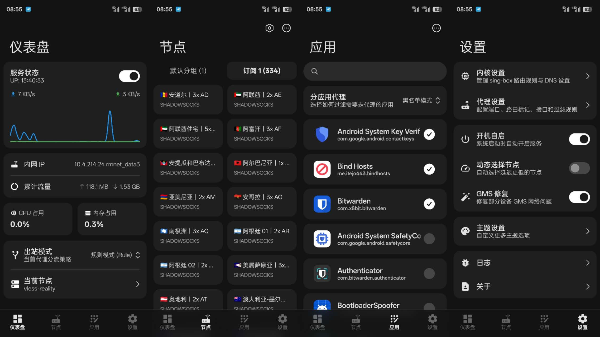

<p align="center">
  
</p>

<h1 align="center">wanBox</h1>

<p align="center">
  <strong>System-wide sing-box transparent proxy module for Android</strong><br>
  eBPF / TUN · Nodes & subscriptions · Per-app proxy · Network sharing
</p>

<p align="center">
  <a href="https://github.com/Wuwan94/wanBoxForAndroid/releases">
    
  </a>
  <a href="https://github.com/Wuwan94/wanBoxForAndroid/releases">
    
  </a>
  
</p>

<p align="center">
  <a href="https://github.com/Wuwan94/wanBoxForAndroid/releases">Download Module & Manager</a> ·
  <a href="https://www.github.com/Wuwan94/wanBoxForAndroid/">Documentation</a> ·
  <a href="src/android/">Manager Source</a> ·
  <a href="https://t.me/OwnBoxs">Telegram</a>
</p>

<p align="center">
  <a href="README.md">中文</a> | English
</p>

---

## Overview

wanBox is a system-wide transparent proxy module for rooted Android devices, supporting **Magisk, KernelSU, and APatch**. It uses sing-box to intercept traffic through eBPF or TUN + auto_redirect.

Manage everyday tasks with the bundled Android Manager, terminal-style module WebUI, CLI, or sing-box Dashboard. Nodes and subscriptions remain available for browsing and editing when the service is stopped.

## Screenshot

<div align="center">
  
</div>

## Features

- **Transparent proxy**: Intercept TCP, UDP, and DNS through eBPF or TUN, with hotspot and USB tethering support.
- **Nodes and subscriptions**: Import node links, node text, Clash YAML, and sing-box JSON, with support for subscription filtering, custom request headers, usage information, and automatic updates.
- **Node selection and latency tests**: Choose nodes manually or use automatic selection; run latency tests even when the service is stopped.
- **Per-app proxy**: Configure blacklists and whitelists separately for each Android user, including cloned apps.
- **Network policies**: Rule, Proxy, Direct, and Rule (allow ads) modes, with automatic switching based on Wi-Fi names and the actual network used.
- **Configuration and diagnostics**: Edit sing-box configuration and local rules, view runtime configuration and logs, and export redacted diagnostic bundles.

## Installation and Getting Started

Requires an `arm64-v8a` Android device with Magisk, KernelSU, or APatch. Traffic interception uses root privileges.

eBPF is selected by default. Choose TUN under **Settings → Inbound settings**. See [Installation and Upgrades](https://www.github.com/Wuwan94/wanBoxForAndroid/guide/installation) for device requirements and installation options.

1. Download `wanBox_<version>_<build>.zip` from [Releases](https://github.com/Wuwan94/wanBoxForAndroid/releases). It includes the module and Android Manager.
2. Flash it in your root manager, choose how to retain data and whether to install the Android Manager, then wait for installation to finish.
3. Open the Android Manager to connect to the module automatically. Import nodes on the **Nodes** page or add a subscription on the **Subscriptions** page.
4. On the **Nodes** page, choose a group and automatic or manual selection, then return to **Dashboard** to start the service.

The service starts manually by default. Enable **Start on boot** in **Settings** for automatic startup. See [Quick Start](https://www.github.com/Wuwan94/wanBoxForAndroid/guide/quick-start) for initial setup.

## Documentation

| Topic | Guide |
|---|---|
| Installation and initial setup | [Installation and Upgrades](https://www.github.com/Wuwan94/wanBoxForAndroid/guide/installation) · [Quick Start](https://www.github.com/Wuwan94/wanBoxForAndroid/guide/quick-start) |
| Nodes, subscriptions, and latency tests | [Nodes and Subscriptions](https://www.github.com/Wuwan94/wanBoxForAndroid/guide/nodes-subscriptions) |
| Inbounds, per-app proxy, and network sharing | [Inbound Configuration](https://www.github.com/Wuwan94/wanBoxForAndroid/config/inbound) · [eBPF](https://www.github.com/Wuwan94/wanBoxForAndroid/config/ebpf) · [TUN](https://www.github.com/Wuwan94/wanBoxForAndroid/config/tun) |
| Automatic network switching | [Wi-Fi Policies](https://www.github.com/Wuwan94/wanBoxForAndroid/guide/wifi-policy) |
| Routing, DNS, and proxy groups | [Configuration Reference](https://www.github.com/Wuwan94/wanBoxForAndroid/config/singbox) · [Proxy Groups](https://www.github.com/Wuwan94/wanBoxForAndroid/config/policy-groups) |
| Terminal, dashboards, and third-party clients | [CLI](https://www.github.com/Wuwan94/wanBoxForAndroid/guide/cli) · [Control Panels and APIs](https://www.github.com/Wuwan94/wanBoxForAndroid/guide/control-panel) |
| Troubleshooting and issue reports | [FAQ and Diagnostics](https://www.github.com/Wuwan94/wanBoxForAndroid/guide/faq) |

[Changelog](https://www.github.com/Wuwan94/wanBoxForAndroid/changelog) · [Privacy Policy](https://www.github.com/Wuwan94/wanBoxForAndroid/privacy)

## Naipi Companions

<p align="center">
  <a href="https://www.github.com/Wuwan94/wanBoxForAndroid/mascot/dragon"></a>
  <a href="https://www.github.com/Wuwan94/wanBoxForAndroid/mascot/niang"></a>
</p>

**Naipi Dragon (奶屁龙)**, the trailblazer of the Pathway Workshop. Loves digging tunnels and taking naps, and occasionally digs an exit straight into the cookie cupboard.

**Naipi Niang (奶屁娘)**, the owner of the Pathway Workshop. Particular and a little proud, she asks "Where are the logs?" while already handing you a warm drink.

[Workshop Stories](https://www.github.com/Wuwan94/wanBoxForAndroid/mascot/) · [Stickers](https://www.github.com/Wuwan94/wanBoxForAndroid/mascot/stickers) · [Supporters](https://www.github.com/Wuwan94/wanBoxForAndroid/mascot/supporters)

## Source Layout

```text
src/module/          Module installation and runtime files
src/native/wanbox/ Native Go component
src/webui/           Terminal-style module WebUI
src/android/         Android Manager
docs/                User documentation
tests/               Contract and regression tests
```

See the [Contributing Guide](CONTRIBUTING.md) for development and verification, [AGENTS.md](AGENTS.md) for architecture and cross-component contracts, and the [Android README](src/android/README.md) for manager builds.

## Acknowledgments

| Project | Role |
|------|------|
| [reF1nd/sing-box](https://github.com/reF1nd/sing-box) | Current proxy core |
| [SagerNet/sing-box](https://github.com/SagerNet/sing-box) | Upstream sing-box project |
| [Proxylink](https://github.com/Wuwan94/wanBoxForAndroid) | Original project behind wanBox's internal node conversion support |
| [AsteriskNG](https://github.com/Asterisk4Magisk/AsteriskNG) | Android eBPF implementation reference |
| [v2rayNG](https://github.com/2dust/v2rayNG) | Node parsing reference |

Thanks also to [CHIZI-0618/sing-box](https://github.com/CHIZI-0618/sing-box), [Xray-core](https://github.com/XTLS/Xray-core), [AndroidTProxyShell](https://github.com/CHIZI-0618/AndroidTProxyShell), [IPSET_LKM](https://github.com/TanakaLun/IPSET_LKM), and [KsuWebUIStandalone](https://github.com/KOWX712/KsuWebUIStandalone) for powering or inspiring earlier versions.

## Community and Contributing

- [Telegram Group](https://t.me/OwnBoxs)
- [Report an Issue](https://github.com/Wuwan94/wanBoxForAndroid/issues)
- [Submit a Pull Request](https://github.com/Wuwan94/wanBoxForAndroid/pulls)

## License

[GPL-3.0 License](LICENSE)

## Star

[](https://star-history.dera.page/#Wuwan94/wanBoxForAndroid&type=date&legend=top-left)
